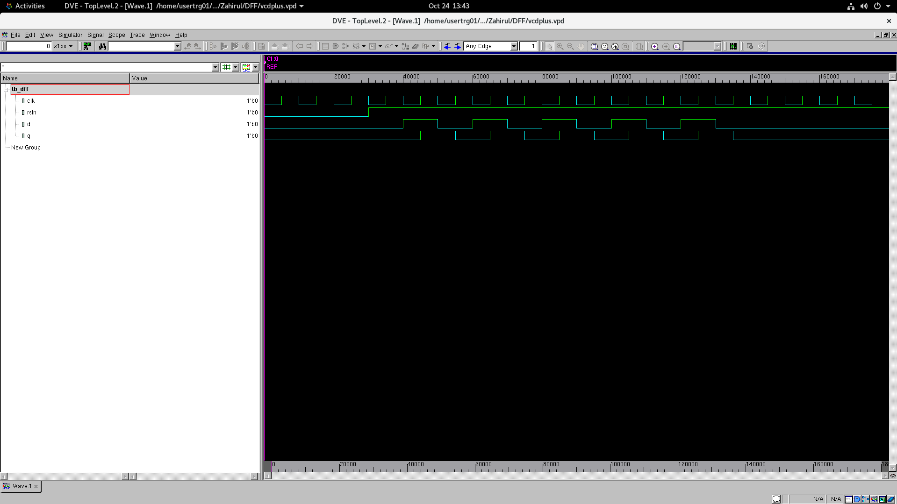

# D Flip-Flop

A normal everyday D flip-flop with asynchronous reset, unremarkable in every way.

## Reason for this repository

I wanted to try Synopsys VCS by compiling and simulating a simple D flip-flop, then viewing the waveforms in Synopsys DVE.

## Commands I used

```sh
vcs -sverilog tb_dff.sv dff.v -debug_access+all
./simv
dve -vpd vcdplus.vpd
```

## D flip-flop simulation in Synopsys DVE


